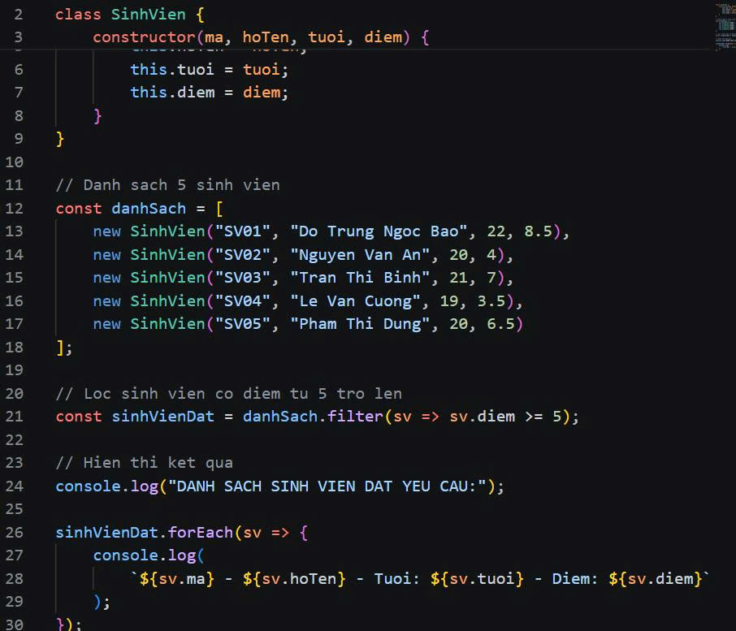
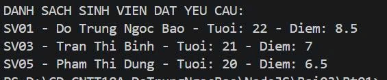

# BÀI 3 - BÀI TẬP 01

## Thông tin sinh viên
- Họ tên: Đỗ Trung Ngọc Bảo
- Lớp: CD-CNTT18A
- Môn học: Node.js

## Yêu cầu bài tập
- Tạo danh sách 5 sinh viên.
- Sử dụng class và constructor.
- Sử dụng arrow function để lọc sinh viên có điểm >= 5.
- Hiển thị kết quả bằng console.log().

## Mô tả mã nguồn
- class SinhVien: Khai báo lớp sinh viên.
- constructor: Khởi tạo thông tin sinh viên.
- filter(): Lọc sinh viên đạt yêu cầu.
- forEach(): Duyệt danh sách sinh viên.
- console.log(): In kết quả ra Terminal.

## Cách chạy chương trình

Mở Terminal tại thư mục Bt01 và nhập:

    node bt01.js

## Kết quả

Chương trình hiển thị 3 sinh viên đạt yêu cầu:
- SV01: Do Trung Ngoc Bao - 8.5 điểm
- SV03: Tran Thi Binh - 7 điểm
- SV05: Pham Thi Dung - 6.5 điểm

## Hình ảnh minh chứng

### Ảnh 1: Mã nguồn

### Ảnh 2: Kết quả chạy

