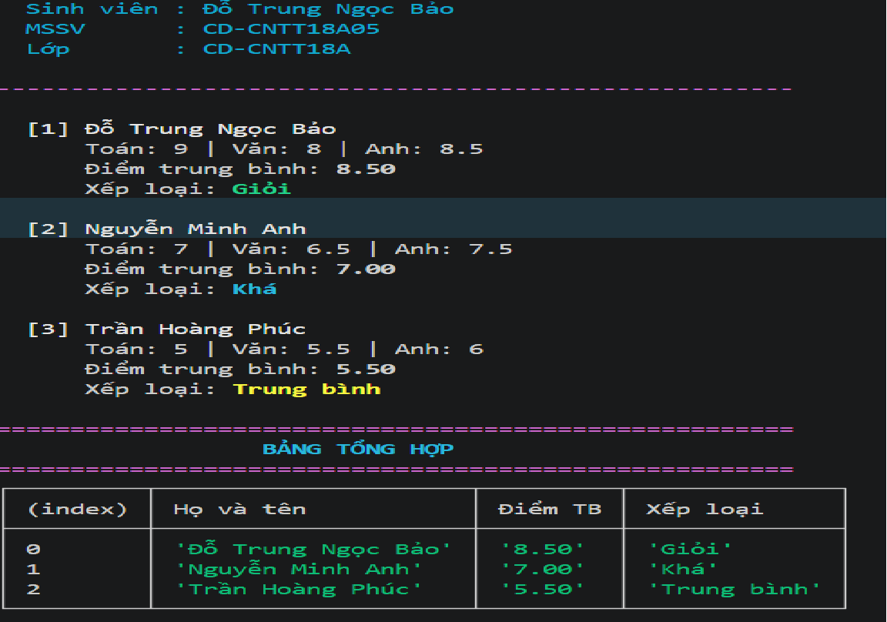
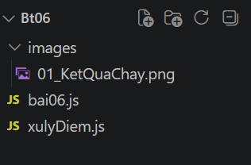

# 📚 BÀI 3 – BT06: XÂY DỰNG MODULE TÍNH KẾT QUẢ HỌC TẬP

## 👨‍🎓 1. THÔNG TIN SINH VIÊN

| Thông tin | Nội dung |
|---|---|
| Họ và tên | Đỗ Trung Ngọc Bảo |
| Mã sinh viên | CD-CNTT18A05 |
| Lớp | CD-CNTT18A |
| Môn học | NodeJS |
| Bài học | Bài 3 – Module, File System và cơ sở dữ liệu |
| Bài thực hành | BT06 – Xây dựng Module tính kết quả học tập |
| Ngôn ngữ | JavaScript |
| Môi trường | Node.js |
| Công cụ | Visual Studio Code |

---

## 🎯 2. MỤC TIÊU BÀI THỰC HÀNH

Bài thực hành nhằm giúp sinh viên hiểu và vận dụng kiến thức về Module trong Node.js.

Sau khi hoàn thành bài thực hành, sinh viên có thể:

- Tạo và sử dụng Module trong Node.js.
- Xây dựng các hàm xử lý dữ liệu bằng JavaScript.
- Sử dụng `module.exports` để xuất các hàm.
- Sử dụng `require()` để gọi các hàm từ Module khác.
- Sử dụng mảng đối tượng để quản lý thông tin sinh viên.
- Tính điểm trung bình của ba môn học.
- Xếp loại kết quả học tập dựa trên điểm trung bình.
- Hiển thị thông tin và bảng kết quả trên Terminal.

---

## 📋 3. YÊU CẦU BÀI THỰC HÀNH

### Yêu cầu 1: Tạo các tập tin

Tạo hai tập tin:

- `bai06.js`: Chương trình chính.
- `xulyDiem.js`: Module xử lý điểm học tập.

### Yêu cầu 2: Xây dựng Module xử lý điểm

Trong file `xulyDiem.js`, xây dựng hai hàm:

**Hàm `tinhDiemTrungBinh()`**

Nhận vào điểm của ba môn học và trả về điểm trung bình.

Công thức:

Điểm trung bình = (Điểm môn 1 + Điểm môn 2 + Điểm môn 3) / 3

**Hàm `xepLoai()`**

Nhận điểm trung bình và trả về kết quả xếp loại học tập.

| Điểm trung bình | Xếp loại |
|---|---|
| Từ 8.0 trở lên | Giỏi |
| Từ 6.5 đến dưới 8.0 | Khá |
| Từ 5.0 đến dưới 6.5 | Trung bình |
| Dưới 5.0 | Yếu |

Hai hàm phải được xuất bằng `module.exports`.

### Yêu cầu 3: Xây dựng chương trình chính

Trong file `bai06.js`:

- Sử dụng `require()` để gọi Module `xulyDiem.js`.
- Tạo dữ liệu của 3 sinh viên.
- Lưu điểm Toán, Văn và Anh.
- Tính điểm trung bình cho từng sinh viên.
- Xếp loại học tập theo điểm trung bình.
- Hiển thị họ tên, điểm từng môn, điểm trung bình và xếp loại.
- Hiển thị bảng tổng hợp kết quả học tập.

---

## 📁 4. CẤU TRÚC THƯ MỤC DỰ ÁN

Dự án được tổ chức như sau:

```text
NodeJS/
└── Bai03/
    └── Bt06/
        ├── bai06.js
        ├── xulyDiem.js
        ├── Readme.md
        └── images/
            ├── 01_KetQuaChay.png
            └── 02_CauTrucDuAn.png
```

**Chức năng của từng tập tin:**

| Tập tin | Chức năng |
|---|---|
| `bai06.js` | Chương trình chính, quản lý dữ liệu sinh viên và hiển thị kết quả |
| `xulyDiem.js` | Chứa các hàm tính điểm trung bình và xếp loại |
| `Readme.md` | Giới thiệu, hướng dẫn chạy và trình bày kết quả bài thực hành |
| `images/` | Lưu hình ảnh minh chứng |
| `01_KetQuaChay.png` | Ảnh chụp kết quả chạy chương trình |
| `02_CauTrucDuAn.png` | Ảnh chụp cấu trúc dự án trong VS Code |

---

## 💻 5. MÃ NGUỒN CHƯƠNG TRÌNH

### 5.1. Module xử lý điểm – xulyDiem.js

```javascript
/*
  BAI 03 - BT06
  MODULE XU LY DIEM HOC TAP

  Sinh vien: Do Trung Ngoc Bao
  MSSV: CD-CNTT18A05
*/

// Ham tinh diem trung binh 3 mon
function tinhDiemTrungBinh(diem1, diem2, diem3) {
    return (diem1 + diem2 + diem3) / 3;
}

// Ham xep loai hoc tap
function xepLoai(diemTB) {
    if (diemTB >= 8) {
        return "Giỏi";
    } else if (diemTB >= 6.5) {
        return "Khá";
    } else if (diemTB >= 5) {
        return "Trung bình";
    } else {
        return "Yếu";
    }
}

// Xuat cac ham
module.exports = {
    tinhDiemTrungBinh,
    xepLoai
};
```

### 5.2. Chương trình chính – bai06.js

Chương trình chính thực hiện các công việc:

1. Gọi Module xử lý điểm bằng `require()`.
2. Khởi tạo dữ liệu ba sinh viên.
3. Duyệt danh sách sinh viên bằng `map()`.
4. Tính điểm trung bình và xếp loại.
5. Hiển thị kết quả từng sinh viên.
6. Xuất bảng tổng hợp bằng `console.table()`.

**Đoạn mã gọi Module:**

```javascript
const { tinhDiemTrungBinh, xepLoai } = require("./xulyDiem");
```

**Dữ liệu sinh viên:**

```javascript
const sinhViens = [
    {
        hoTen: "Đỗ Trung Ngọc Bảo",
        toan: 9,
        van: 8,
        anh: 8.5
    },
    {
        hoTen: "Nguyễn Minh Anh",
        toan: 7,
        van: 6.5,
        anh: 7.5
    },
    {
        hoTen: "Trần Hoàng Phúc",
        toan: 5,
        van: 5.5,
        anh: 6
    }
];
```

**Đoạn mã xử lý kết quả:**

```javascript
const ketQua = sinhViens.map((sv) => {
    const diemTB = tinhDiemTrungBinh(
        sv.toan,
        sv.van,
        sv.anh
    );

    const loai = xepLoai(diemTB);

    return {
        hoTen: sv.hoTen,
        diemTB: diemTB,
        xepLoai: loai
    };
});
```

**Hiển thị bảng tổng hợp:**

```javascript
console.table(ketQua.map(sv => ({
    "Họ và tên": sv.hoTen,
    "Điểm TB": sv.diemTB.toFixed(2),
    "Xếp loại": sv.xepLoai
})));
```

Ngoài các đoạn mã chính, file `bai06.js` còn sử dụng mã màu ANSI để tạo giao diện Terminal Dark Neon.

Mã nguồn đầy đủ được lưu trong hai file JavaScript của dự án.

---

## ▶️ 6. HƯỚNG DẪN CHẠY CHƯƠNG TRÌNH

### Bước 1: Chuẩn bị môi trường

Máy tính cần cài đặt:

- Node.js
- Visual Studio Code

### Bước 2: Mở dự án

Mở thư mục `Bt06` bằng Visual Studio Code.

### Bước 3: Mở Terminal

Trong VS Code, chọn:

**Terminal → New Terminal**

### Bước 4: Kiểm tra Node.js

Nhập lệnh:

```bash
node -v
```

Nếu Terminal hiển thị phiên bản Node.js, môi trường đã sẵn sàng.

### Bước 5: Chạy chương trình

Nhập:

```bash
node bai06.js
```

Nhấn Enter để thực thi.

### Bước 6: Kiểm tra kết quả

Terminal sẽ hiển thị:

- Thông tin sinh viên thực hiện bài.
- Danh sách 3 sinh viên.
- Điểm Toán, Văn và Anh.
- Điểm trung bình.
- Xếp loại học tập.
- Bảng tổng hợp kết quả.

**Lưu ý:** Chương trình không cần cài thêm thư viện npm, không sử dụng cơ sở dữ liệu và không cần chạy máy chủ web.

---

## 📊 7. KẾT QUẢ THỰC HIỆN

### 7.1. Bảng điểm chi tiết

| STT | Họ và tên | Toán | Văn | Anh | Điểm TB | Xếp loại |
|---|---|---:|---:|---:|---:|---|
| 1 | Đỗ Trung Ngọc Bảo | 9.0 | 8.0 | 8.5 | 8.50 | Giỏi |
| 2 | Nguyễn Minh Anh | 7.0 | 6.5 | 7.5 | 7.00 | Khá |
| 3 | Trần Hoàng Phúc | 5.0 | 5.5 | 6.0 | 5.50 | Trung bình |

### 7.2. Kết quả trên Terminal

```text
======================================================
          STUDY RESULT DASHBOARD - NODEJS BT06
======================================================

Sinh viên : Đỗ Trung Ngọc Bảo
MSSV      : CD-CNTT18A05
Lớp       : CD-CNTT18A

------------------------------------------------------

[1] Đỗ Trung Ngọc Bảo
    Toán: 9 | Văn: 8 | Anh: 8.5
    Điểm trung bình: 8.50
    Xếp loại: Giỏi

[2] Nguyễn Minh Anh
    Toán: 7 | Văn: 6.5 | Anh: 7.5
    Điểm trung bình: 7.00
    Xếp loại: Khá

[3] Trần Hoàng Phúc
    Toán: 5 | Văn: 5.5 | Anh: 6
    Điểm trung bình: 5.50
    Xếp loại: Trung bình

======================================================
                  BẢNG TỔNG HỢP
======================================================

HOÀN THÀNH! Đã xử lý kết quả cho 3 sinh viên.
```

### 7.3. Nhận xét kết quả

Chương trình đã:

- Tính chính xác điểm trung bình của ba môn.
- Xếp loại đúng theo các mức điểm được quy định.
- Xử lý thành công danh sách ba sinh viên.
- Hiển thị kết quả rõ ràng trên Terminal.
- Sử dụng Module để tách phần xử lý điểm và chương trình chính.

---

## 📸 8. HÌNH ẢNH MINH CHỨNG

### 8.1. Kết quả chạy chương trình

Hình ảnh minh chứng chương trình chạy thành công bằng lệnh `node bai06.js`.



### 8.2. Cấu trúc thư mục dự án

Hình ảnh minh chứng các file `bai06.js`, `xulyDiem.js`, `Readme.md` và thư mục `images` trong Visual Studio Code.



---

## 🧠 9. KIẾN THỨC ÁP DỤNG

### 9.1. Module trong Node.js

Module giúp chia chương trình thành nhiều tập tin có chức năng riêng biệt, thuận tiện cho việc quản lý và tái sử dụng mã nguồn.

### 9.2. module.exports

Dùng để xuất hàm hoặc dữ liệu từ một Module.

```javascript
module.exports = {
    tinhDiemTrungBinh,
    xepLoai
};
```

### 9.3. require()

Dùng để nhập và sử dụng Module trong chương trình khác.

```javascript
const { tinhDiemTrungBinh, xepLoai } = require("./xulyDiem");
```

### 9.4. Array và Object

Sử dụng mảng chứa các đối tượng sinh viên để quản lý thông tin và điểm số.

### 9.5. Hàm map()

Sử dụng `map()` để xử lý từng sinh viên và tạo danh sách kết quả mới.

### 9.6. console.table()

Hiển thị dữ liệu dưới dạng bảng trong Terminal, giúp dễ quan sát và kiểm tra.

---

## 🧪 10. KIỂM TRA CHỨC NĂNG

| STT | Nội dung kiểm tra | Kết quả |
|---|---|---|
| 1 | Tạo Module xử lý điểm | Đạt |
| 2 | Xuất hàm bằng module.exports | Đạt |
| 3 | Gọi Module bằng require() | Đạt |
| 4 | Tạo dữ liệu 3 sinh viên | Đạt |
| 5 | Tính điểm trung bình | Đạt |
| 6 | Xếp loại Giỏi, Khá, Trung bình | Đạt |
| 7 | Xây dựng điều kiện xếp loại Yếu | Đạt |
| 8 | Hiển thị bảng tổng hợp | Đạt |
| 9 | Chạy chương trình trên Node.js | Đạt |

*Lưu ý: Dữ liệu mẫu gồm ba sinh viên, chưa có sinh viên xếp loại Yếu. Tuy nhiên, hàm `xepLoai()` đã có điều kiện xử lý mức điểm này.*

---

## ✨ 11. ĐẶC ĐIỂM CỦA CHƯƠNG TRÌNH

- Cấu trúc mã nguồn rõ ràng, dễ hiểu.
- Tách riêng Module xử lý điểm.
- Không sử dụng thư viện bên ngoài.
- Giao diện Terminal có màu sắc Dark Neon.
- Hiển thị thông tin từng sinh viên.
- Có bảng tổng hợp kết quả.
- Có thể mở rộng để quản lý nhiều sinh viên hơn.
- Phù hợp với kiến thức Bài 3 về Module trong Node.js.

---

## 📝 12. KẾT LUẬN

Qua bài thực hành **BT06 – Xây dựng Module tính kết quả học tập**, sinh viên đã vận dụng được kiến thức về Module trong Node.js.

Chương trình sử dụng `module.exports` và `require()` để tổ chức mã nguồn thành các tập tin riêng biệt, thực hiện tính điểm trung bình và xếp loại học tập cho ba sinh viên.

Kết quả chương trình được hiển thị trên Terminal với bảng tổng hợp rõ ràng, đáp ứng các yêu cầu chính của bài thực hành.

**KẾT QUẢ: HOÀN THÀNH BÀI THỰC HÀNH BT06.**

---

**Sinh viên thực hiện:** Đỗ Trung Ngọc Bảo  
**MSSV:** CD-CNTT18A05  
**Lớp:** CD-CNTT18A  
**Môn học:** NodeJS