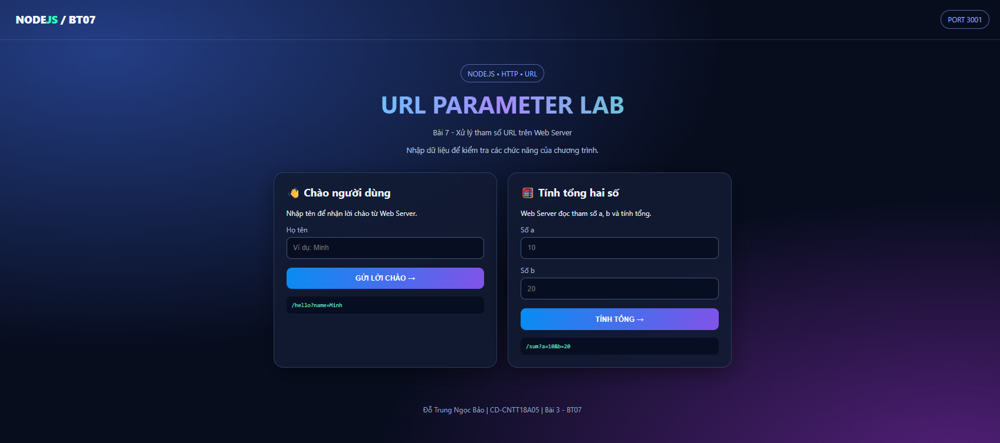
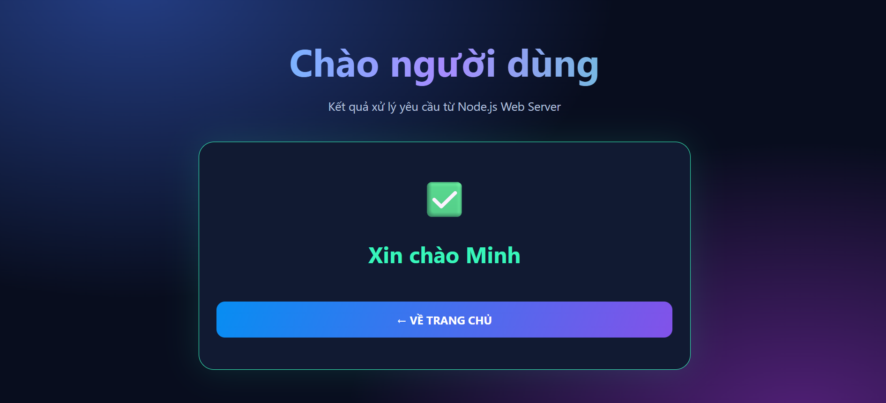
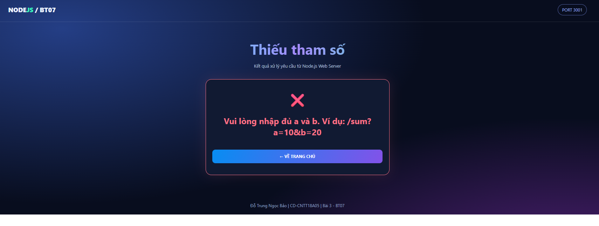

# 🌐 BÀI 3 – BÀI TẬP 07
# XỬ LÝ THAM SỐ URL TRÊN WEB SERVER BẰNG NODE.JS

**NODE.JS | HTTP MODULE | URL PARAMETERS | WEB SERVER**

---

## 👨‍🎓 1. THÔNG TIN SINH VIÊN

| Thông tin | Nội dung |
|---|---|
| Họ và tên | Đỗ Trung Ngọc Bảo |
| Mã sinh viên | CD-CNTT18A05 |
| Lớp | CD-CNTT18A |
| Môn học | NodeJS |
| Bài học | Bài 3 – Module, File System và cơ sở dữ liệu |
| Bài tập | BT07 – Xử lý tham số URL trên Web Server |
| Ngôn ngữ | JavaScript |
| Môi trường | Node.js |
| Công cụ | Visual Studio Code |
| Cổng Web Server | 3001 |

---

## 🎯 2. MỤC TIÊU BÀI THỰC HÀNH

Bài thực hành nhằm tìm hiểu cách xây dựng Web Server bằng Node.js và xử lý các tham số được truyền qua URL.

Sau khi hoàn thành, sinh viên có thể:

- Sử dụng module `http` có sẵn trong Node.js.
- Khởi tạo Web Server tại cổng `3001`.
- Sử dụng đối tượng `URL` để phân tích đường dẫn.
- Đọc tham số bằng `searchParams.get()`.
- Xử lý yêu cầu HTTP từ trình duyệt.
- Thực hiện chức năng chào người dùng theo tên.
- Tính tổng hai số được truyền qua URL.
- Kiểm tra tham số bị thiếu hoặc không hợp lệ.
- Trả về thông báo lỗi phù hợp.
- Hiển thị kết quả trên giao diện web.

---

## 📋 3. YÊU CẦU BÀI TẬP

### 3.1. Yêu cầu lập trình

Tạo tập tin `bai07.js` và thực hiện:

1. Sử dụng module `http` và đối tượng `URL`.
2. Tạo Web Server tại cổng `3001`.
3. Khi truy cập `/hello?name=Minh`, hiển thị `Xin chào Minh`.
4. Khi truy cập `/sum?a=10&b=20`, hiển thị `Tổng = 30`.
5. Trả về thông báo lỗi khi thiếu tham số hoặc giá trị không hợp lệ.
6. Chạy chương trình bằng lệnh `node bai07.js`.

### 3.2. Yêu cầu nộp bài

Bài thực hành được lưu trong repository GitHub `NodeJS`, theo đường dẫn:

`NodeJS/Bai03/Bt07`

Thư mục BT07 bao gồm:

- Tập tin mã nguồn `bai07.js`.
- Tập tin hướng dẫn `Readme.md`.
- Thư mục `images` lưu ảnh chạy chương trình và kết quả.

---

## 📁 4. CẤU TRÚC THƯ MỤC

```text
NodeJS/
└── Bai03/
    └── Bt07/
        ├── bai07.js
        ├── Readme.md
        └── images/
            ├── 01_TrangChu.png
            ├── 02_ChaoNguoiDung.png
            ├── 03_TinhTong.png
            └── 04_KiemTraLoi.png
```

**Giải thích:**

| Tập tin / Thư mục | Chức năng |
|---|---|
| `bai07.js` | Chứa chương trình Web Server Node.js |
| `Readme.md` | Mô tả bài thực hành và hướng dẫn chạy |
| `images/` | Lưu ảnh minh họa kết quả |
| `01_TrangChu.png` | Giao diện trang chủ |
| `02_ChaoNguoiDung.png` | Kết quả chức năng chào |
| `03_TinhTong.png` | Kết quả tính tổng |
| `04_KiemTraLoi.png` | Kết quả kiểm tra lỗi |

---

## ⚙️ 5. CÔNG NGHỆ SỬ DỤNG

### 5.1. Node.js

Node.js là môi trường thực thi JavaScript, cho phép xây dựng các ứng dụng phía máy chủ.

### 5.2. HTTP Module

Module `http` được sử dụng để tạo Web Server và tiếp nhận yêu cầu từ trình duyệt.

```javascript
const http = require("http");
```

### 5.3. Đối tượng URL

Đối tượng `URL` cho phép phân tích địa chỉ truy cập và đọc tham số.

Ví dụ:

```javascript
const url = new URL(req.url, "http://localhost:3001");

const pathname = url.pathname;
const name = url.searchParams.get("name");
```

### 5.4. HTML và CSS

HTML và CSS được sử dụng để xây dựng giao diện web, hiển thị biểu mẫu, thông báo và kết quả xử lý.

Giao diện được thiết kế theo phong cách **Dark Neon**, sử dụng nền tối, hiệu ứng chuyển màu và các thẻ chức năng.

---

## 🚀 6. HƯỚNG DẪN CHẠY CHƯƠNG TRÌNH

### Bước 1: Mở dự án

Mở Visual Studio Code và chọn thư mục:

`NodeJS/Bai03/Bt07`

### Bước 2: Mở Terminal

Trong VS Code, chọn:

**Terminal → New Terminal**

Kiểm tra Terminal đang ở đúng thư mục `Bt07`.

### Bước 3: Chạy Web Server

Nhập lệnh:

```bash
node bai07.js
```

Nhấn **Enter** để khởi động chương trình.

### Bước 4: Mở trình duyệt

Truy cập địa chỉ:

**http://localhost:3001/**

Trang chủ sẽ hiển thị giao diện của ứng dụng.

### Bước 5: Kiểm tra các chức năng

**Chức năng chào người dùng:**

http://localhost:3001/hello?name=Minh

**Chức năng tính tổng:**

http://localhost:3001/sum?a=10&b=20

**Kiểm tra thiếu tham số:**

http://localhost:3001/hello

http://localhost:3001/sum?a=10

**Kiểm tra dữ liệu không hợp lệ:**

http://localhost:3001/sum?a=abc&b=20

**Kiểm tra đường dẫn không tồn tại:**

http://localhost:3001/abc

**Lưu ý:** Các địa chỉ `localhost` chỉ truy cập được khi Web Server đang chạy trên máy tính.

---

## 🖥️ 7. CÁC CHỨC NĂNG CHÍNH

### 7.1. Giao diện trang chủ

Đường dẫn:

`http://localhost:3001/`

Trang chủ có:

- Tiêu đề **URL PARAMETER LAB**.
- Thông tin bài thực hành.
- Khu vực nhập tên người dùng.
- Khu vực nhập hai số.
- Các nút thực hiện chức năng.
- Giao diện nền tối, màu sắc hiện đại.

### 7.2. Chức năng chào người dùng

**Đường dẫn:**

`/hello?name=Minh`

**Nguyên lý:**

1. Trình duyệt gửi yêu cầu đến Web Server.
2. Server xác định đường dẫn `/hello`.
3. Đọc tham số `name`.
4. Kiểm tra tên có hợp lệ hay không.
5. Trả về lời chào.

**Kết quả mong đợi:**

```text
Xin chào Minh
```

### 7.3. Chức năng tính tổng

**Đường dẫn:**

`/sum?a=10&b=20`

**Nguyên lý:**

1. Server tiếp nhận yêu cầu.
2. Xác định đường dẫn `/sum`.
3. Đọc hai tham số `a` và `b`.
4. Kiểm tra hai giá trị.
5. Chuyển dữ liệu sang kiểu số.
6. Thực hiện phép cộng.
7. Trả kết quả về trình duyệt.

**Kết quả mong đợi:**

```text
Tổng = 30
```

### 7.4. Chức năng kiểm tra lỗi

Chương trình xử lý các trường hợp:

- Không truyền tên người dùng.
- Không truyền tham số `a`.
- Không truyền tham số `b`.
- Truyền dữ liệu không phải số.
- Truy cập đường dẫn không tồn tại.

Các lỗi được hiển thị dưới dạng thông báo rõ ràng để người dùng biết nguyên nhân.

---

## 🧪 8. BẢNG KIỂM THỬ CHƯƠNG TRÌNH

| STT | URL kiểm thử | Kết quả mong đợi |
|---|---|---|
| 1 | `/` | Hiển thị trang chủ |
| 2 | `/hello?name=Minh` | Xin chào Minh |
| 3 | `/hello?name=Bao` | Xin chào Bao |
| 4 | `/sum?a=10&b=20` | Tổng = 30 |
| 5 | `/sum?a=5&b=7` | Tổng = 12 |
| 6 | `/sum?a=-5&b=10` | Tổng = 5 |
| 7 | `/hello` | Thông báo thiếu tên |
| 8 | `/hello?name=` | Thông báo tên không hợp lệ |
| 9 | `/sum?a=10` | Thông báo thiếu tham số |
| 10 | `/sum?b=20` | Thông báo thiếu tham số |
| 11 | `/sum?a=abc&b=20` | Thông báo giá trị không hợp lệ |
| 12 | `/sum?a=10&b=xyz` | Thông báo giá trị không hợp lệ |
| 13 | `/abc` | Thông báo đường dẫn không tồn tại |

Bảng trên là các trường hợp dùng để kiểm thử. Cần chạy và đối chiếu với kết quả thực tế của chương trình.

---

## 📸 9. HÌNH ẢNH MINH HỌA

### 9.1. Giao diện trang chủ

Hình ảnh hiển thị trang chủ Web Server tại cổng `3001`.



### 9.2. Kết quả chào người dùng

Kiểm thử chức năng `/hello` với tham số `name`.



### 9.3. Kết quả tính tổng hai số

Kiểm thử chức năng `/sum` với hai tham số `a` và `b`.



### 9.4. Kết quả kiểm tra dữ liệu không hợp lệ

Kiểm thử chức năng thông báo lỗi khi nhập giá trị không phải số.


---

## 🔄 10. QUY TRÌNH HOẠT ĐỘNG

```text
       NGƯỜI DÙNG
            |
            v
     TRUY CẬP URL
            |
            v
     NODE.JS WEB SERVER
        PORT 3001
            |
            v
      PHÂN TÍCH URL
            |
            v
     KIỂM TRA ĐƯỜNG DẪN
            |
       +----+----+
       |         |
       v         v
     /hello     /sum
       |         |
       v         v
    ĐỌC name   ĐỌC a, b
       |         |
       +----+----+
            |
            v
    KIỂM TRA THAM SỐ
            |
       +----+----+
       |         |
       v         v
     HỢP LỆ   KHÔNG HỢP LỆ
       |         |
       v         v
    XỬ LÝ     BÁO LỖI
       |         |
       +----+----+
            |
            v
     TRẢ VỀ KẾT QUẢ
            |
            v
       TRÌNH DUYỆT
```

---

## 💡 11. KIẾN THỨC ĐÃ ÁP DỤNG

### 11.1. Import module

Sử dụng `require()` để nạp module có sẵn của Node.js.

### 11.2. Khởi tạo Web Server

Sử dụng `http.createServer()` để tiếp nhận và xử lý các yêu cầu HTTP.

### 11.3. Xử lý URL

Sử dụng `URL` để xác định đường dẫn và các tham số được gửi từ trình duyệt.

### 11.4. Xử lý điều kiện

Sử dụng các câu lệnh điều kiện để lựa chọn chức năng và kiểm tra dữ liệu.

### 11.5. Trả kết quả HTTP

Sử dụng các phương thức:

- `res.writeHead()`
- `res.end()`

để gửi phản hồi về trình duyệt.

### 11.6. Kiểm tra dữ liệu

Kiểm tra dữ liệu đầu vào trước khi thực hiện phép tính nhằm hạn chế lỗi và đảm bảo kết quả chính xác.

---

## 📚 12. TÀI LIỆU THAM KHẢO

- [Node.js Documentation](https://nodejs.org/docs/latest/api/)
- [Node.js HTTP Module](https://nodejs.org/api/http.html)
- [MDN – URL API](https://developer.mozilla.org/en-US/docs/Web/API/URL)
- [Bài 3 – Module, File System và cơ sở dữ liệu](https://hoctructuyencntt.github.io/NodeJS/Bai03.html)

---

## 🏁 13. KẾT LUẬN

Bài thực hành **BT07 – Xử lý tham số URL trên Web Server** tập trung vào việc sử dụng Node.js để xây dựng Web Server và xử lý dữ liệu được truyền qua URL.

Chương trình được thiết kế để thực hiện các chức năng:

- Hiển thị trang chủ.
- Chào người dùng theo tên.
- Tính tổng hai số.
- Kiểm tra tham số đầu vào.
- Thông báo lỗi khi dữ liệu không hợp lệ.
- Xử lý đường dẫn không tồn tại.

Thông qua bài thực hành, sinh viên củng cố kiến thức về module `http`, đối tượng `URL`, cách xử lý HTTP Request và HTTP Response, đồng thời rèn luyện kỹ năng xây dựng ứng dụng Web Server bằng JavaScript.

---

**BÀI 3 – BT07 | NODE.JS WEB SERVER**

**Sinh viên thực hiện: Đỗ Trung Ngọc Bảo**

**MSSV: CD-CNTT18A05 | Lớp: CD-CNTT18A**