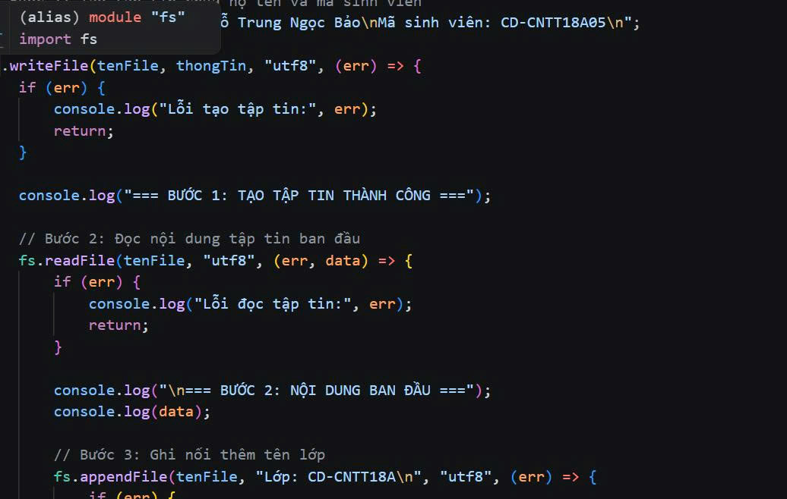
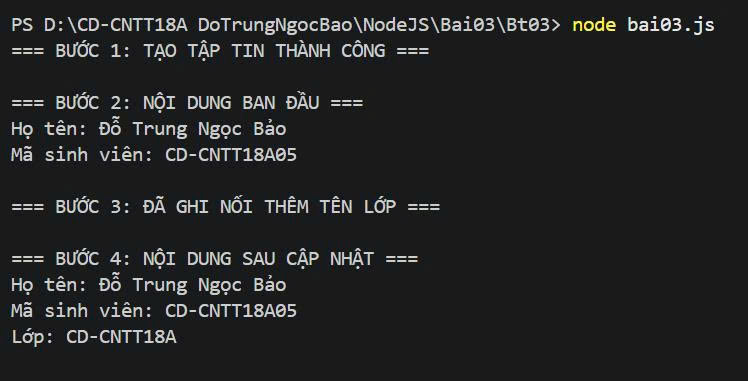
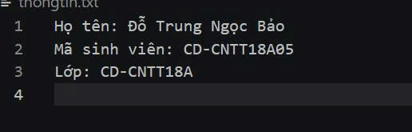

# BÀI 3 – BÀI TẬP 03: THAO TÁC TẬP TIN BẰNG FILE SYSTEM

## 1. Thông tin sinh viên

- **Họ và tên:** Đỗ Trung Ngọc Bảo
- **Mã sinh viên:** CD-CNTT18A05
- **Lớp:** CD-CNTT18A
- **Môn học:** Node.js

## 2. Yêu cầu bài tập

Sử dụng module `fs` trong Node.js để:

- Tạo tập tin `thongtin.txt` chứa họ tên và mã sinh viên.
- Đọc và hiển thị nội dung tập tin lên Terminal.
- Ghi nối thêm tên lớp bằng hàm `appendFile()`.
- Đọc lại tập tin để kiểm tra nội dung đã được cập nhật.

## 3. Cấu trúc thư mục

```text
NodeJS/
└── Bai03/
    └── Bt03/
        ├── bai03.js
        ├── thongtin.txt
        ├── Readme.md
        └── IMAGES/
            ├── 1-code.png
            ├── 2-terminal.png
            └── 3-thongtin.png
```

## 4. Mô tả các lệnh

- `require("fs")`: Sử dụng module File System.
- `fs.writeFile()`: Tạo và ghi dữ liệu vào tập tin.
- `fs.readFile()`: Đọc nội dung tập tin.
- `fs.appendFile()`: Ghi nối thêm tên lớp.
- `console.log()`: Hiển thị kết quả trên Terminal.

## 5. Hướng dẫn chạy chương trình

Mở Terminal trong thư mục `Bt03`.

Kiểm tra phiên bản Node.js:

```powershell
node -v
```

Chạy chương trình:

```powershell
node bai03.js
```

## 6. Kết quả thực hiện

### Bước 1: Tạo tập tin

Chương trình tạo tập tin `thongtin.txt` chứa họ tên và mã sinh viên.

### Bước 2: Đọc nội dung ban đầu

```text
Họ tên: Đỗ Trung Ngọc Bảo
Mã sinh viên: CD-CNTT18A05
```

### Bước 3: Ghi nối thêm tên lớp

Sử dụng `fs.appendFile()` để thêm:

```text
Lớp: CD-CNTT18A
```

### Bước 4: Đọc lại tập tin

Nội dung cuối cùng của `thongtin.txt`:

```text
Họ tên: Đỗ Trung Ngọc Bảo
Mã sinh viên: CD-CNTT18A05
Lớp: CD-CNTT18A
```

## 7. Hình ảnh minh chứng

### Ảnh 1: Mã nguồn chương trình



### Ảnh 2: Kết quả chạy Terminal



### Ảnh 3: Nội dung tập tin thongtin.txt



## 8. Kết luận

Đã xây dựng chương trình Node.js sử dụng module File System để tạo, đọc, ghi nối và cập nhật nội dung tập tin `thongtin.txt`.

**Kết quả:** Hoàn thành Bài 3 – Bài tập 03.